# YOLOv8 Multi-Class Brain Hemorrhage Object Detection & Spatial Localization

[](https://github.com/Uguravsar75/YOLOv8-Brain-Hemorrhage-Detection/actions/workflows/ci.yml)
[](https://colab.research.google.com/github/Uguravsar75/YOLOv8-Brain-Hemorrhage-Detection/blob/main/notebooks/brain_hemorrhage_colab.ipynb)
[](https://www.python.org/)
[](https://github.com/ultralytics/ultralytics)
[](https://pytorch.org/)
[](https://riverbankcomputing.com/software/pyqt/)
[](https://github.com/Uguravsar75/YOLOv8-Brain-Hemorrhage-Detection/releases/tag/v1.0.0)
[](LICENSE)

**CE 480 Deep Learning — Project 3**  
End-to-end **5-class spatial bounding-box object detection and anatomical localization** of intracranial hemorrhage subtypes (**`EDH`**, **`IPH`**, **`IVH`**, **`SAH`**, **`SDH`**) on axial head CT scans using **Ultralytics YOLOv8n** (Anchor-Free Decoupled Head + C2f Backbone + PANet Multi-Scale Neck), systematic **Single-Variable Ablation Studies** (Resolution, NMS IoU, Confidence Thresholds), **Greedy IoU Spatial Error Analysis (FP/FN)**, and a **PyQt Dark-Mode Clinical Decision-Support Desktop GUI**.

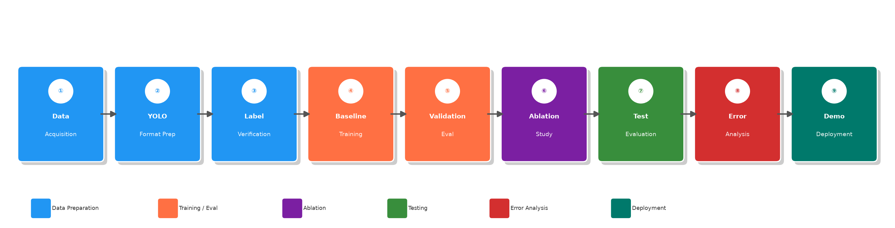

---

## Key Technological Highlights

- **Spatial Object Detection vs. Image-Level Classification:** Rather than binary image-level classification, this system performs real-time **multi-class bounding-box localization** across 5 distinct intracranial hemorrhage subtypes (`EDH`, `IPH`, `IVH`, `SAH`, `SDH`), estimating lesion coordinates `[x1, y1, x2, y2]`, frame area coverage (`%`), and subtype confidence scores.
- **Anchor-Free YOLOv8n Architecture:** Utilizes a `C2f` cross-stage partial backbone, a Path Aggregation Network (`PANet`) multi-scale feature pyramid neck, and an anchor-free decoupled detection head (`3.0M` parameters, `8.1 GFLOPs`) optimized with **Task-Aligned Assigner**, **CIoU + Distribution Focal Loss (DFL)**, and **AdamW**.
- **Controlled Single-Variable Ablation Framework:** Evaluates the impact of spatial resolution (`640×640` vs. `960×960`), Non-Maximum Suppression IoU threshold (`0.50` vs. `0.70`), and post-processing confidence thresholds (`0.001`–`0.20`).
- **Automated BBox-Level FP/FN Error Analysis:** Implements greedy 1-to-1 IoU matching (`IoU ≥ 0.50`) between predicted and ground-truth boxes to isolate and visualize False Positives (skull bone/calcification mimics) and False Negatives (small peripheral or low-contrast lesions).
- **PyQt Dark-Mode Clinical Desktop GUI:** Interactive cross-platform (`PyQt5` / `PyQt6`) desktop application featuring live Confidence and NMS IoU sliders, side-by-side CT scan visualization, structured technical telemetry, and plain-language clinical summaries.

---

## Project Structure

```text
├── main.py                              # Unified CLI entry point (check, verify_labels, train, ablation, evaluate, error_analysis, gui, all)
├── requirements.txt                     # Python dependencies
├── LICENSE                              # MIT License
├── .github/workflows/ci.yml             # GitHub Actions CI pipeline running unit tests
├── app/
│   └── app_desktop.py                   # PyQt5/PyQt6 Dark-Mode Clinical Desktop GUI
├── src/
│   ├── __init__.py                      # Class definitions and metadata
│   ├── label_verify.py                  # Ground-truth YOLO bounding-box verification & 4x5 gallery generator
│   ├── train.py                         # Baseline YOLOv8n training pipeline (AdamW, early stopping, CUDA/MPS/CPU)
│   ├── ablation.py                      # Ablation A (imgsz 640 vs 960) & Ablation B2 (Confidence sweep)
│   ├── ablation_iou.py                  # Ablation B1 (NMS IoU threshold 0.50 vs 0.70 comparison)
│   ├── evaluate.py                      # Held-out Validation vs. Test set evaluation & per-class mAP breakdown
│   └── error_analysis.py                # Greedy IoU bbox matching for False Positive / False Negative grids
├── saved_models/
│   ├── README.md                        # Model weights documentation
│   └── baseline_best.pt                 # Trained YOLOv8n 5-class hemorrhage detector weights (6.0 MB — included in repo)
├── dataset/
│   ├── README.md                        # Dataset setup & class distribution documentation
│   └── data.yaml                        # YOLOv8 dataset configuration (5 classes: EDH, IPH, IVH, SAH, SDH)
├── samples/                             # 50 sample axial Head CT scans across all 5 subtypes (EDH, IPH, IVH, SAH, SDH)
├── notebooks/
│   └── brain_hemorrhage_colab.ipynb     # End-to-end Google Colab training & ablation notebook
├── results/
│   ├── flowchart.png                    # 9-stage system pipeline diagram
│   ├── gui_screenshot.png               # PyQt desktop GUI screenshot with live bounding-box detection
│   ├── baseline/                        # Training curves, PR curve, F1 curve, normalized confusion matrix
│   ├── ablation/                        # Resolution, NMS IoU, and Confidence sweep comparison plots & CSVs
│   ├── full_test/                       # Per-class and overall Validation vs. Test comparison charts
│   ├── error_analysis/                  # 2x3 False Positive and False Negative bounding-box grids
│   └── label_gallery/                   # 20-image ground-truth bounding-box verification gallery
└── tests/
    └── test_pipeline.py                 # Automated unit tests for coordinate transforms, IoU matching, and inference
```

---

## Dataset & Hemorrhage Subtypes

The dataset ([Roboflow Brain Hemorrhage Detection v1](https://universe.roboflow.com/yolo-v5-h7oh7/brain-hemorrhage-detection-8f8o0)) consists of ~355 original head CT slices expanded via augmentation to **719 training**, **78 validation**, and **36 held-out test** images (`seed=42`).

| Class ID | Code | Subtype | Anatomical Location | ~BBoxes |
| :---: | :---: | :--- | :--- | :---: |
| `0` | **EDH** | Epidural Hematoma | Between skull and dura mater | ~300 |
| `1` | **IPH** | Intraparenchymal Hemorrhage | Within brain parenchyma | ~120 |
| `2` | **IVH** | Intraventricular Hemorrhage | Inside cerebral ventricles | ~80 |
| `3` | **SAH** | Subarachnoid Hemorrhage | Subarachnoid space (pia/arachnoid) | ~42 |
| `4` | **SDH** | Subdural Hematoma | Below dura mater, over cortex | ~150 |

<p align="center">
  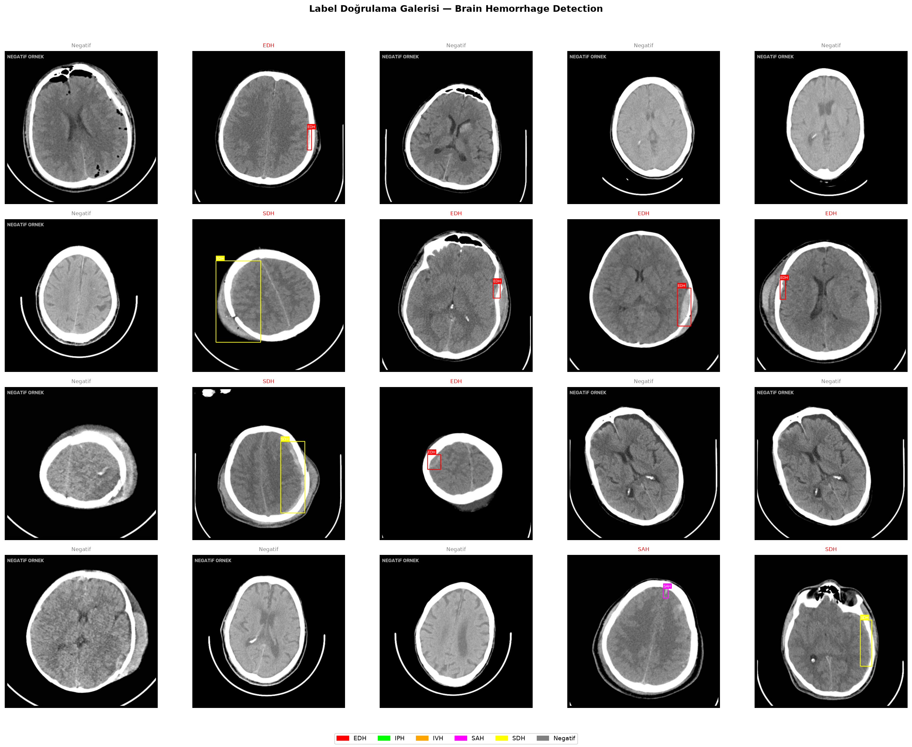
</p>

---

## Experimental Results & Ablation Studies

### 1. Validation vs. Held-Out Test Set Performance (`imgsz=640`, `NMS IoU=0.50`)

| Metric | Validation Set | Held-Out Test Set |
| :--- | :---: | :---: |
| **mAP@0.5** | `0.5110` | **`0.6618`** |
| **mAP@0.5:0.95** | `0.2414` | **`0.3009`** |
| **Precision** | **`0.8692`** | `0.7159` |
| **Recall (Sensitivity)** | `0.4181` | **`0.6157`** |
| **F1-Score** | `0.5646` | **`0.6621`** |

<p align="center">
  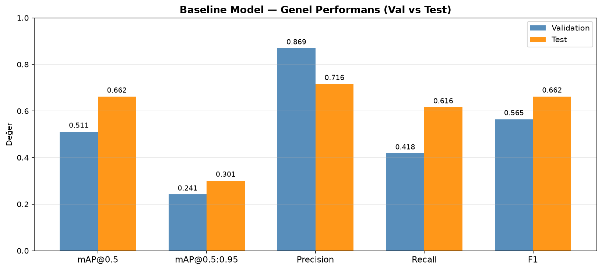
  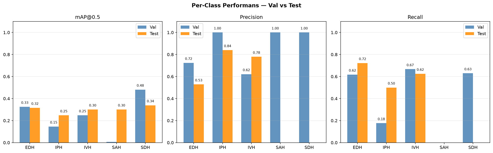
</p>

<p align="center">
  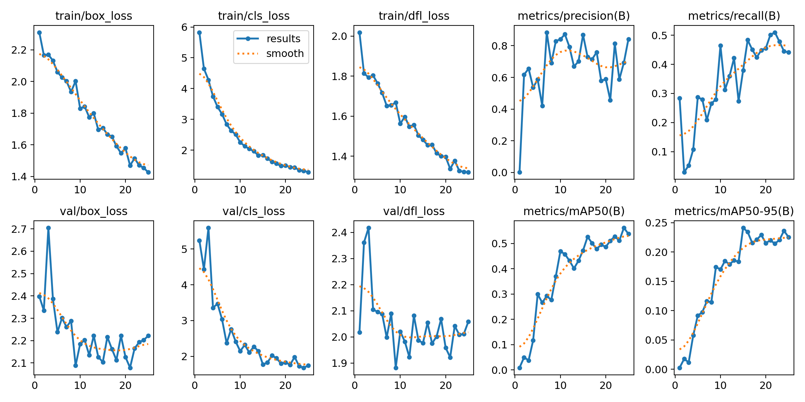
  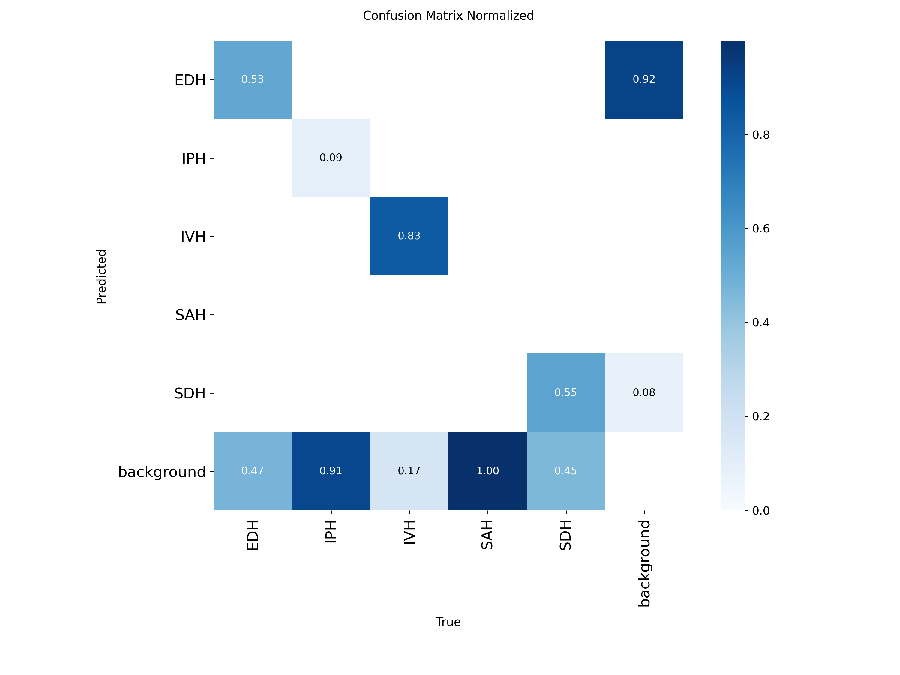
</p>

<p align="center">
  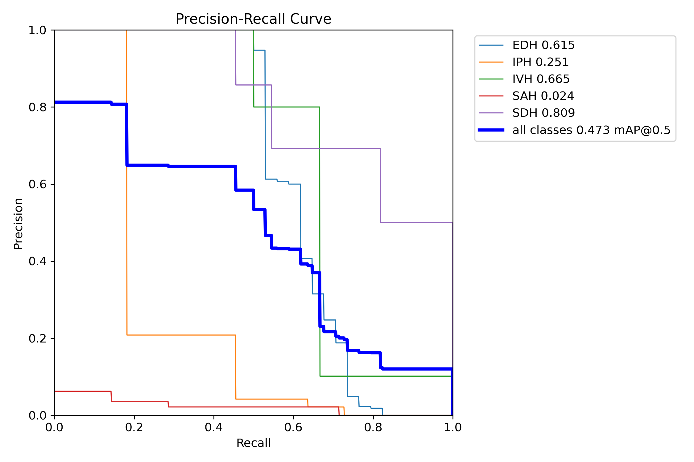
  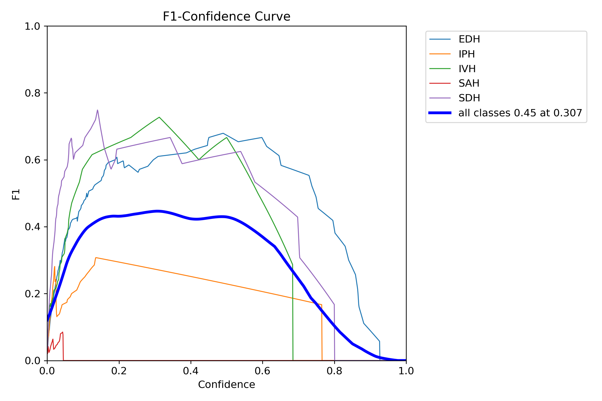
</p>

### 2. Controlled Ablation Studies

#### Ablation A — Input Spatial Resolution (`640×640` vs. `960×960`)
| Configuration | mAP@0.5 | mAP@0.5:0.95 | Precision | Recall | F1-Score |
| :--- | :---: | :---: | :---: | :---: | :---: |
| **Baseline (`imgsz=640`)** | `0.4721` | `0.2414` | **`0.8688`** | `0.3797` | `0.5284` |
| **Ablation A (`imgsz=960`)** | **`0.5489`** | **`0.2461`** | `0.6456` | **`0.4919`** | **`0.5583`** |
| **Relative Delta** | **`+16.2%`** | **`+2.0%`** | `-25.7%` | **`+29.5%`** | **`+5.7%`** |

#### Ablation B1 & B2 — NMS IoU & Confidence Threshold Optimization
| Experiment | Parameter | mAP@0.5 | Precision | Recall | F1-Score |
| :--- | :---: | :---: | :---: | :---: | :---: |
| **Ablation B1 (NMS IoU)** | **`IoU = 0.50` (Optimal)** | **`0.5110`** | **`0.8692`** | **`0.4181`** | **`0.5646`** |
| **Ablation B1 (NMS IoU)** | `IoU = 0.70` | `0.4721` | `0.8688` | `0.3797` | `0.5284` |
| **Ablation B2 (Confidence)** | `conf = 0.001` | **`0.5110`** | **`0.8692`** | `0.4181` | `0.5646` |
| **Ablation B2 (Confidence)** | **`conf = 0.100` (Best F1)** | `0.4484` | `0.8641` | **`0.4198`** | **`0.5651`** |
| **Ablation B2 (Confidence)** | `conf = 0.200` | `0.3685` | `0.7177` | `0.3665` | `0.4852` |

<p align="center">
  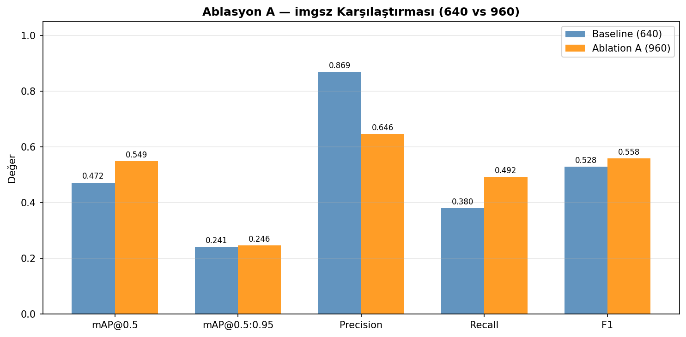
  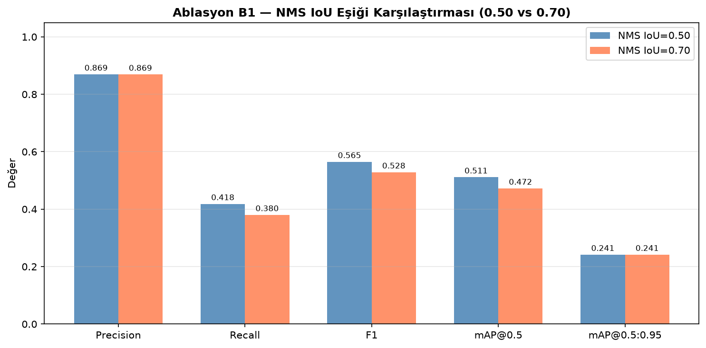
  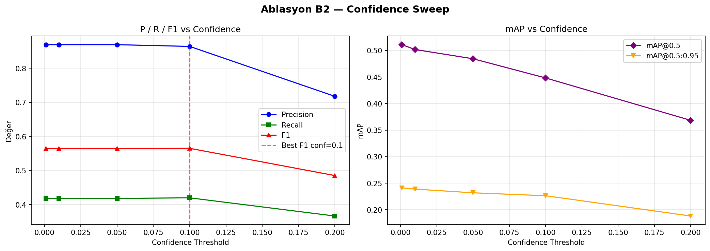
</p>

### 3. Spatial Bounding-Box Error Analysis (FP / FN)

<p align="center">
  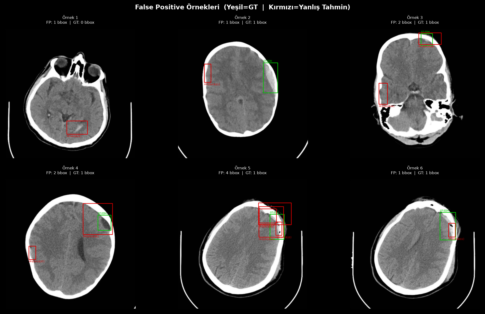
  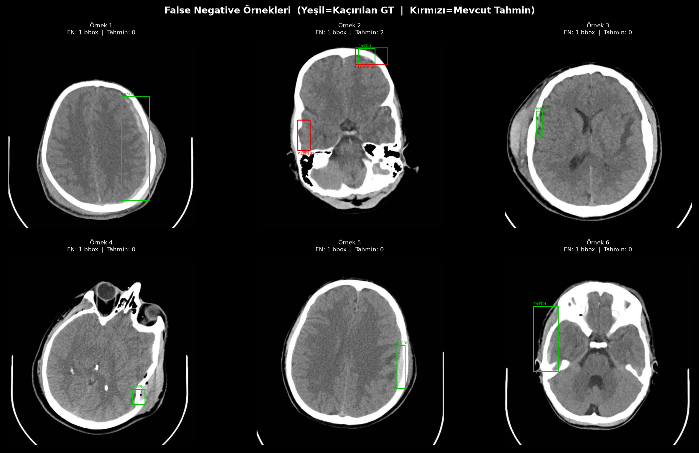
</p>

---

## Installation & Usage

### 1. Install Dependencies
```bash
pip install -r requirements.txt
```

### 2. Pretrained Model Weights & Sample Data
- **Model Weights:** `saved_models/baseline_best.pt` (`6.0 MB`) is **included directly in the repository** — no external weight download is required to run inference or launch the GUI.
- **Sample CT Scans:** 50 curated axial CT images across all 5 subtypes (`EDH`, `IPH`, `IVH`, `SAH`, `SDH`) are included in [`samples/`](samples/) for instant testing.

### 3. CLI Execution Modes
```bash
# Check project files, dataset splits, model weights, and GPU/MPS acceleration
python main.py --mode check

# Launch the PyQt Dark-Mode Clinical Desktop GUI
python main.py --mode gui

# Generate 20-image ground-truth bounding-box verification gallery
python main.py --mode verify_labels

# Evaluate trained model on Validation and Held-Out Test sets
python main.py --mode evaluate

# Run NMS IoU and Confidence threshold ablation sweeps
python main.py --mode ablation

# Generate False Positive / False Negative spatial error analysis grids
python main.py --mode error_analysis

# Train YOLOv8n baseline model from scratch
python main.py --mode train --epochs 50 --batch 8 --imgsz 640

# Run unit tests
python -m unittest discover -s tests -v
```

### Desktop GUI (`app/app_desktop.py`)
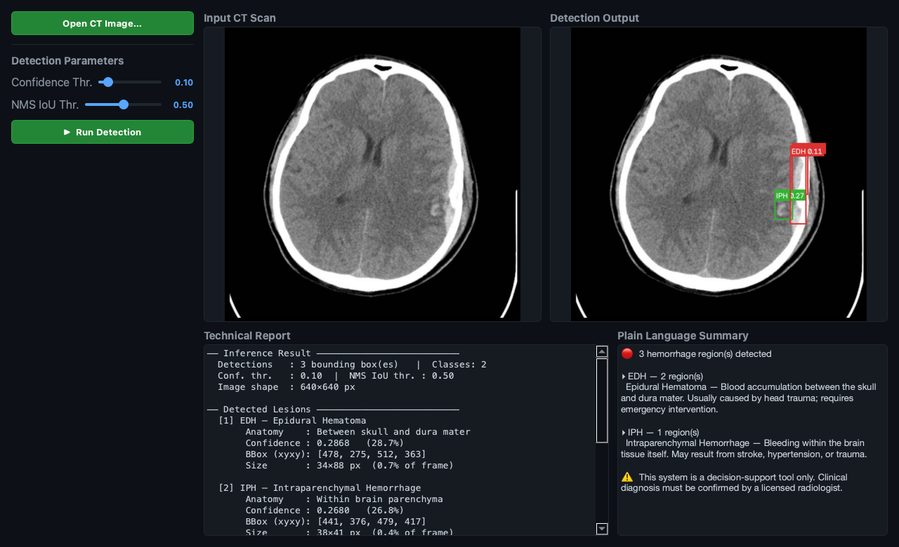
